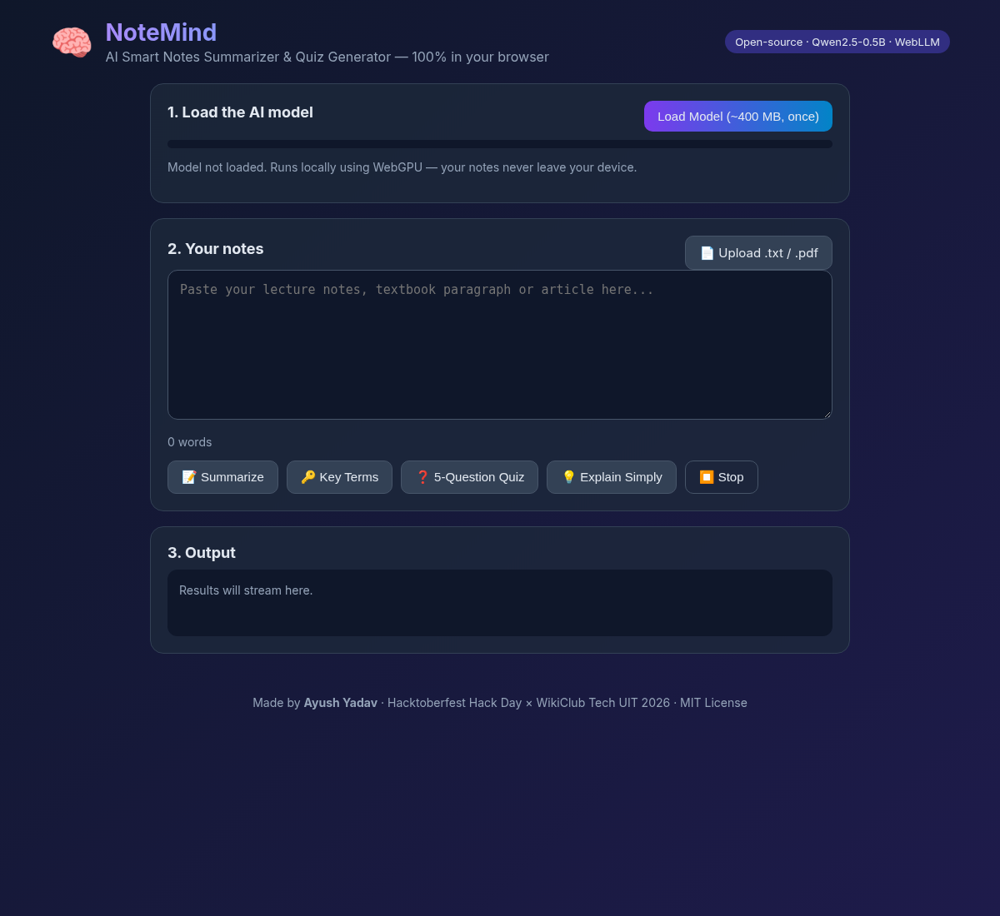

# 🧠 NoteMind – AI Smart Notes Summarizer & Quiz Generator

Built for **Hacktoberfest Hack Day × WikiClub Tech UIT – Edition 1.0** · Challenge: **Best Open-Source AI Project**
Author: **Ayush Yadav**

🔗 **Live demo:** https://notemind-vert.vercel.app · **Repo:** https://github.com/ayush8620/notemind



## ❓ Problem
Students have long lecture notes and PDFs but little time to revise. Most AI study tools need paid APIs, accounts, and send private notes to remote servers.

## 💡 Solution
NoteMind is a free, open-source web app that runs an **open-weight LLM fully inside the browser**. Paste notes or upload a `.txt`/`.pdf` and instantly get:
- 📝 **Summary** in bullet points
- 🔑 **Key terms** with short definitions
- ❓ **Interactive 5-question MCQ quiz** with instant feedback and score
- 💡 **Simple explanation** (ELI12 style)

No server, no API key, no data leaves your device. Works offline after the first model download.

## 🛠 Tech Stack
- HTML, CSS, vanilla JavaScript (ES modules)
- [WebLLM](https://github.com/mlc-ai/web-llm) (`@mlc-ai/web-llm`, Apache-2.0) – in-browser LLM inference via WebGPU
- [PDF.js](https://mozilla.github.io/pdf.js/) 3.11.174 (Apache-2.0) – PDF text extraction

## 🤖 AI Model
- **Model:** Qwen2.5-0.5B-Instruct (WebLLM build `Qwen2.5-0.5B-Instruct-q4f16_1-MLC`, 4-bit quantized)
- **Source:** https://huggingface.co/Qwen/Qwen2.5-0.5B-Instruct
- **License:** Apache-2.0 – https://huggingface.co/Qwen/Qwen2.5-0.5B-Instruct/blob/main/LICENSE

## ⚙️ How AI is integrated
1. On "Load Model", WebLLM downloads the quantized Qwen2.5 weights (~400 MB, cached in browser) and compiles them for the GPU with WebGPU, showing a progress bar.
2. Each button sends the notes with a task-specific prompt through WebLLM's OpenAI-compatible `chat.completions.create` API with `stream: true`, so text appears token by token.
3. For the quiz, the model is prompted to output JSON; the app parses it and renders clickable MCQs with correct/wrong highlighting and a final score.
4. If the browser lacks WebGPU, a clear fallback message is shown.

## 🚀 Installation & Usage
```bash
git clone https://github.com/ayush8620/notemind.git
cd notemind
python3 -m http.server 8000   # any static server works
```
Open http://localhost:8000 in **Chrome / Edge 113+ (desktop)**, click **Load Model**, paste notes, choose an action.
Can also be deployed for free on GitHub Pages / Vercel / Netlify (static files only).

## ⚠️ Requirements & Known Limitations
- Needs a browser with **WebGPU** (desktop Chrome/Edge 113+). Most phones are not supported yet; the app shows a message instead.
- First load downloads ~400 MB of model weights, so use good Wi-Fi.
- A 0.5B model is small: summaries and quizzes are short and can sometimes be inaccurate. Check important facts.

## 🏗 Built During the Event
This repository was created and all code was written on **16 Oct 2026** during Hacktoberfest Hack Day (UIT Prayagraj). No earlier project code was reused. Open-source libraries (WebLLM, PDF.js) are loaded from CDNs.

## 🤝 AI Tools Transparency
An AI coding assistant helped with parts of the code and documentation. All code was reviewed and understood by the author.

## 🎃 Contributing (Hacktoberfest)
Contributions are welcome! See [CONTRIBUTING.md](CONTRIBUTING.md). Ideas: flashcards export, more languages, larger-model selector, dark mode.

## 👥 Team
- **Ayush Yadav** (solo): idea, frontend, AI integration, docs

## 📁 Files
`index.html` · `style.css` · `app.js` · `README.md` · `CONTRIBUTING.md` · `LICENSE` · `screenshot.png`

## 📜 License
This project is licensed under the **MIT License** – see [LICENSE](LICENSE).
The Qwen2.5 model is licensed under Apache-2.0 by Alibaba Cloud.


## GPU compatibility
NoteMind auto-picks the model: `q4f16_1` if your GPU supports `shader-f16`, otherwise `q4f32_1`. Devices without WebGPU get a clear message.

## Cloud fallback (backend)
If WebGPU or the model download fails (or you tick **Use cloud AI**), NoteMind calls `/api/chat`, a Vercel serverless function that forwards the request to Groq's OpenAI-compatible API (`https://api.groq.com/openai/v1/chat/completions`).

- Default model: **openai/gpt-oss-20b** (open-weight, Apache-2.0). Automatic fallback: **qwen/qwen3.8-27b**. Override with the `GROQ_MODEL` env var.
- Set `GROQ_API_KEY` in Vercel (Project → Settings → Environment Variables). The key is never stored in the repo.
- In cloud mode, notes are sent to the server/Groq; in WebGPU mode they stay on your device.
